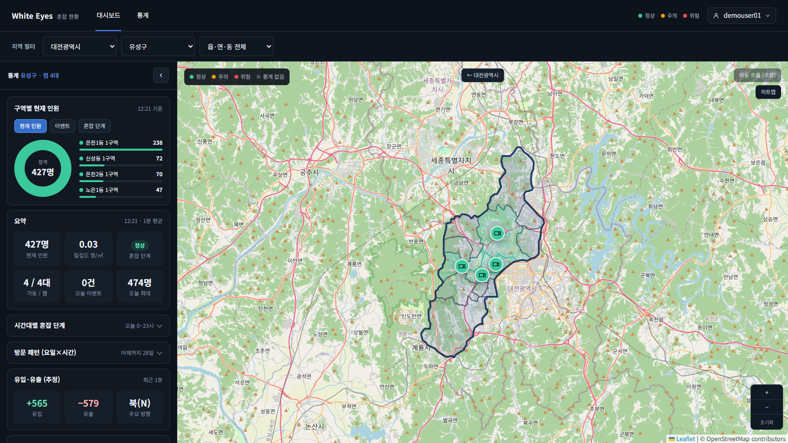
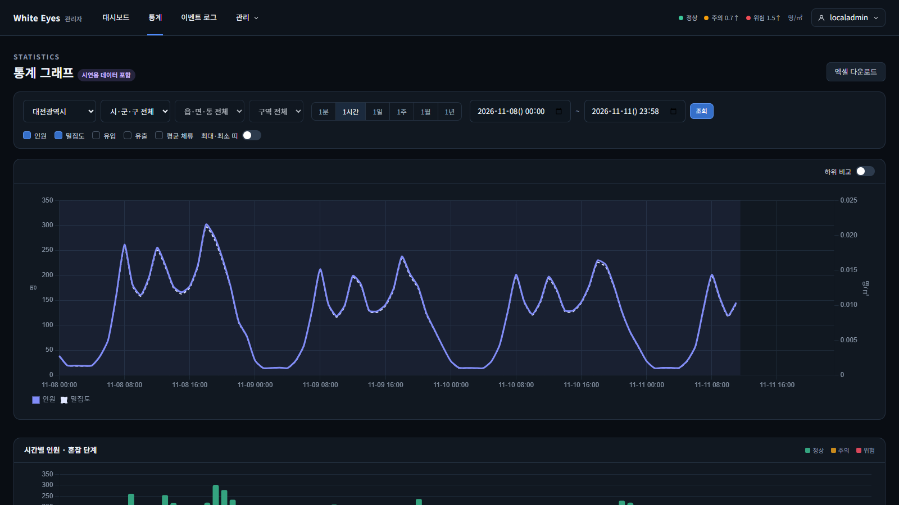
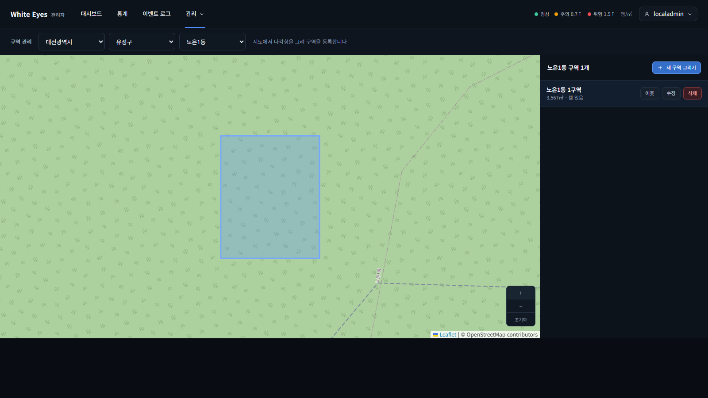
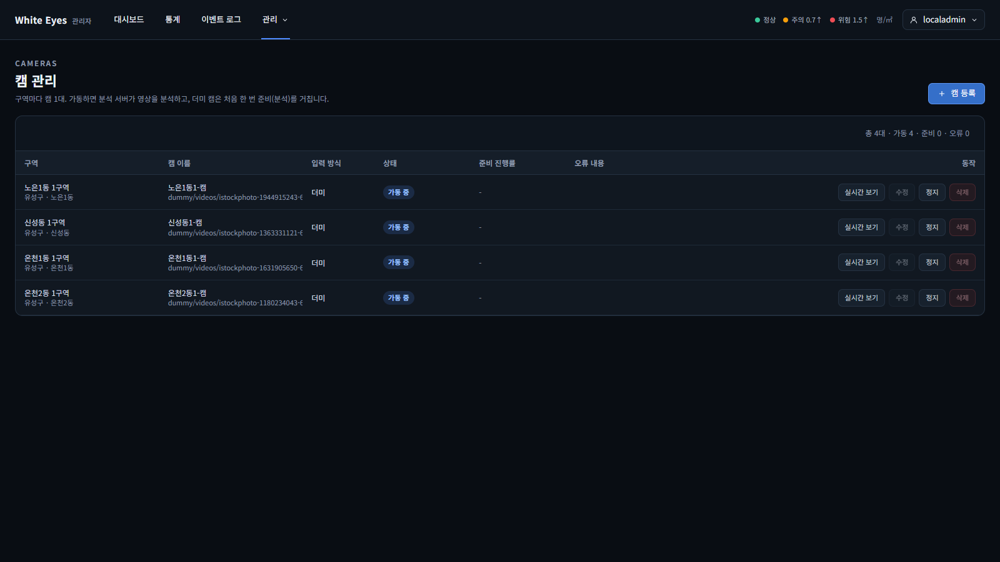

# white-eyes-spring

White Eyes의 **사용자 앱과 관리자 앱**(Spring Boot). 통계를 보여주는 사용자 앱, 캠·구역·계정을 운영하고 분석 결과를 모아 집계하는 관리자 앱, 둘이 함께 쓰는 공통 모듈로 이루어져 있다.

> 프로젝트 전체 소개: [white-eyes-introduce](https://github.com/white-eyes1/white-eyes-introduce) · 명세: [white-eyes-docs](https://github.com/white-eyes1/white-eyes-docs) · 분석 서버: [white-eyes-flask](https://github.com/white-eyes1/white-eyes-flask) · 전체 실행: [white-eyes-deploy](https://github.com/white-eyes1/white-eyes-deploy)


## 구성

| 모듈 | 역할 | 포트 |
|---|---|---|
| `common` | 두 앱이 함께 쓰는 모듈. 데이터 모델·DB 접근, 권한, 공통 응답·예외, 작업 기록, **통계 조회와 통계 화면(한 벌)**, 세션 설정. 단독으로 실행되지 않는다 | - |
| `user` | 사용자 앱(외부 공개). 회원가입·로그인·내 정보, 지도·그래프·대시보드, 통계 엑셀 내려받기, 실시간 갱신. 통계는 읽기만 한다 | 8080 |
| `admin` | 관리자 앱(운영·수집). 계정·구역·캠 관리, 캠 가동·정지(분석 서버에 지시), 분석 결과 수신·집계, 이벤트 판정·처리, 영상 권한 확인, **예약 작업과 Flyway는 여기서만** | 웹 8081, 내부 API 8082 |
| `tools` | 개발·시연용 명령줄 도구(행정구역 SQL 생성, 시연용 통계 생성·삭제). 운영 이미지에는 넣지 않는다 | - |

두 앱으로 나눈 이유는 장애·배포 분리, 관리 기능을 외부 공개 앱에서 떼어내는 보안, 사용자 트래픽과 수집·집계의 부하 분리다. 예약 작업과 DB 마이그레이션을 두 앱에 모두 두면 중복 실행되므로 관리자 앱에서만 돈다.

```
white-eyes-spring
├─ common/   공통 모듈 (account, camera, event, history, level, region, security, stat, web ...)
├─ user/     사용자 앱 (account, history, stat ...)
├─ admin/    관리자 앱 (account, camera, event, media, notification, region, stat, cleanup ...)
├─ tools/    도구 (demo, region)
├─ docs/     트러블슈팅 기록
└─ .github/  CI, PR·이슈 템플릿
```

패키지·계층·의존 규칙은 [package-structure.md](https://github.com/white-eyes1/white-eyes-docs/blob/main/package-structure.md), 코드 컨벤션은 [code-conventions.md](https://github.com/white-eyes1/white-eyes-docs/blob/main/code-conventions.md)를 따른다. 계층 규칙 일부는 ArchUnit 테스트로 검사한다.

## 주요 기능

| 앱 | 기능 |
|---|---|
| 사용자 | 회원가입(관리자 승인 후 이용), 로그인·내 정보 |
| 사용자 | 시·구·동·구역 지도와 혼잡 단계 색, 구역 간 이동 흐름, 시간대별 히트맵 |
| 사용자 | 기간·단위별 통계 그래프, 대시보드(현재 현황, 피크 타임, 방문 패턴, 비정상 변동) |
| 사용자 | 통계 엑셀 다운로드(작업 기록을 남김), SSE로 새 통계 실시간 반영 |
| 관리자 | 구역(지도에서 다각형 그리기)·캠 등록·수정·삭제, 이웃 구역 설정, 캠 가동·정지 |
| 관리자 | 분석 서버가 보낸 결과 수신, 1분·시간별·일별 통계 집계, 빠진 집계 보충, 오래된 기록 정리 |
| 관리자 | 혼잡·급증·캠 이상 이벤트 판정과 알림, 확인 → 조치완료 처리, 이벤트 엑셀 |
| 관리자 | 실시간 화면·다시보기 권한 확인(파일 전송은 nginx가 담당) |
| 관리자 | 사용자 승인/미승인, 관리자 계정 생성·비활성화, 최근 활동·강제 로그아웃, 작업 기록 |

기능 ID(`FNC-U-*`, `FNC-A-*`, `FNC-C-*`)와 상세는 [features/](https://github.com/white-eyes1/white-eyes-docs/tree/main/features), 화면은 [screens.md](https://github.com/white-eyes1/white-eyes-docs/blob/main/screens.md), 브라우저 API는 [api/public.md](https://github.com/white-eyes1/white-eyes-docs/blob/main/api/public.md)에 있다.

## 화면

| 사용자 앱 대시보드 | 관리자 앱 통계 그래프 |
|---|---|
|  |  |

| 관리자 앱 구역 관리(지도에서 구역 그리기) | 관리자 앱 캠 관리 |
|---|---|
|  |  |

> white-eyes-deploy의 `docker compose`로 직접 띄워 캡처했다. 통계 그래프에는 시연용 데이터가 포함되어 있다(화면에도 표시됨). 분석 영상의 원본 장면은 싣지 않았다.

## 분석 서버와의 연결

관리자 앱이 분석 서버([white-eyes-flask](https://github.com/white-eyes1/white-eyes-flask))와 HTTP로만 통신한다. 서로의 코드를 가져다 쓰지 않는다. 계약은 [api/analyzer.md](https://github.com/white-eyes1/white-eyes-docs/blob/main/api/analyzer.md)이다.

| 방향 | 내용 |
|---|---|
| 관리자 앱 → 분석 서버 | 캠 분석 시작·정지 지시 |
| 분석 서버 → 관리자 앱 | 분석 결과(1초마다), 캠 상태, 녹화 등록, 다시 켜졌을 때 '가동 중이어야 하는 캠' 목록 조회 |

## 기술 스택

| 영역 | 내용 |
|---|---|
| 언어·프레임워크 | Java 17, Spring Boot 4.1.1 |
| 빌드 | Gradle 멀티모듈(common / user / admin / tools) |
| 데이터 | Spring Data JPA, MySQL, Flyway(관리자 앱만 실행) |
| 보안·세션 | Spring Security, bcrypt, Spring Session JDBC(세션을 DB에 저장) |
| 화면 | Thymeleaf + HTML/CSS/JavaScript, Chart.js, Leaflet |
| 실시간 | SSE(서버 → 브라우저 단방향) |
| 엑셀·지도 계산 | Apache POI, JTS(구역 면적·소속 동 판정) |
| 로깅 | Log4j2 |
| 품질 | JUnit, H2(시험용 DB), ArchUnit, Spotless(Java 형식), Prettier·ESLint(화면 JS), GitHub Actions |

## 시작하기

전체를 한 번에 띄우려면 [white-eyes-deploy](https://github.com/white-eyes1/white-eyes-deploy)의 `docker compose up -d --build`가 가장 쉽다. 아래는 앱을 직접 띄우는 개발용 방법이다.

### 준비
- JDK 17, (화면 JS 검사용) Node 22
- MySQL 8.4: white-eyes-deploy 폴더에서 `docker compose up -d mysql`

### 환경변수
```bash
cp .env.example .env     # 값을 채운다. 비밀값은 커밋하지 않는다
set -a; source .env; set +a
```

### 실행
관리자 앱을 **먼저** 띄운다. 시작할 때 Flyway가 표를 만들고 사용자 앱 계정에 표 권한을 준다.

```bash
# 관리자 앱
DB_USERNAME=white_eyes_admin DB_PASSWORD=$ADMIN_DB_PASSWORD \
FLYWAY_DB_USERNAME=white_eyes_flyway FLYWAY_DB_PASSWORD=$FLYWAY_DB_PASSWORD \
./gradlew :admin:bootRun --args='--spring.profiles.active=local'

# 사용자 앱
DB_USERNAME=white_eyes_user DB_PASSWORD=$USER_DB_PASSWORD \
./gradlew :user:bootRun --args='--spring.profiles.active=local'
```

### 빌드·테스트
```bash
./gradlew build                  # 빌드 + 테스트 + Java 형식 검사
./gradlew spotlessApply          # Java 형식 정리
npm ci && npm run lint           # 화면 JS 검사 (정리는 npm run format)
```

### 시연용 통계
월·연 단위 통계처럼 영상만으로는 채울 수 없는 과거 데이터는 `tools`의 `generate-demo` 명령으로 만든다. 시연용 데이터는 local·dev에만 넣고 prod에는 넣지 않는다. 사용법은 [tools/demo/README.md](tools/demo/README.md)에 있다.

## 협업 규칙

- 작업은 GitHub 이슈 하나 단위다. 이슈의 기능 ID(`FNC-*`)에 해당하는 명세를 읽고 나서 코드를 쓴다.
- 브랜치는 `feature/<이슈 번호>-<이름>`, PR 대상은 `dev`이다. `main`·`dev`에 직접 push하지 않는다.
- 커밋 메시지는 [commit-convention.md](https://github.com/white-eyes1/white-eyes-docs/blob/main/commit-convention.md)를 따른다.
- 키·비밀번호는 환경변수로만 다루고, 더미 영상·시연 데이터·가중치 파일은 커밋하지 않는다.
- 테이블·칼럼은 [tables.md](https://github.com/white-eyes1/white-eyes-docs/blob/main/tables.md)와 같아야 한다.
- 오래 걸린 문제를 해결하면 [docs/troubleshooting/](docs/troubleshooting/)에 기록한다.

더 자세한 작업 규칙은 [CLAUDE.md](CLAUDE.md)에 있다.

## 관련 저장소

| 저장소 | 설명 |
|---|---|
| [white-eyes-introduce](https://github.com/white-eyes1/white-eyes-introduce) | 프로젝트 소개 |
| [white-eyes-flask](https://github.com/white-eyes1/white-eyes-flask) | 영상 분석 서버 |
| [white-eyes-docs](https://github.com/white-eyes1/white-eyes-docs) | 명세·API 계약·결정 기록 |
| [white-eyes-deploy](https://github.com/white-eyes1/white-eyes-deploy) | docker compose 실행 설정 |
